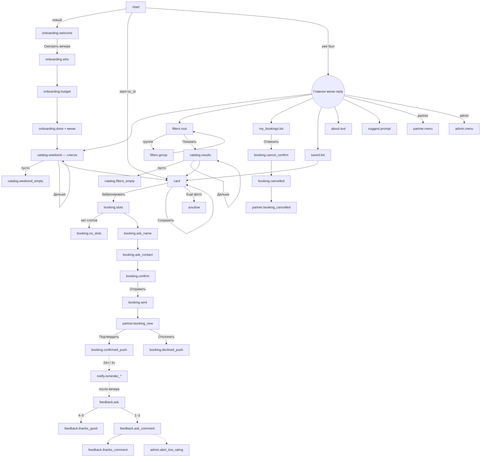

# Дизайн «Сургутский плейс» — Telegram-бот

Версия 2 · 27.10.2026 (добавлены картинки, ротация, сезоны, /help; см. §18–19) · владелец: designer. Источник истины по моделям и сервисам — `docs/contract.md`.

Этот документ — спецификация интерфейса бота: экраны, переходы, клавиатуры и **готовые тексты**. Frontend переносит тексты в `app/bot/texts.py` как есть, по ключам (`onboarding.welcome` → например `ONBOARDING_WELCOME` или словарь `T["onboarding.welcome"]` — на выбор frontend, ключи стабильны).

---

## 0. Общие правила

### 0.1 Голос и тон
- На «вы», но по-соседски. Коротко: одно сообщение помещается на экран телефона без прокрутки (кроме карточки).
- Лёгкая ирония про Сургут (зима, вахта, Обь, мосты, нефть) — **не больше одной шутки на сообщение**, и никогда в ошибках, отказах, отменах и сообщениях про деньги.
- Без канцелярита («Ваша заявка успешно зарегистрирована» → «Заявка у партнёра»), без восклицательных знаков подряд, без капса.
- Миссия звучит только в «О проекте». В остальных местах не пафосничаем.

### 0.2 Разметка
- `parse_mode=HTML`. Используем только `<b>`, `<i>`, `<a href>`, `<code>` (в админке).
- **Любые значения, введённые людьми** (`{name}`, `{title}`, `{comment}`, `{address}`, `{timing_text}` и т.п.), экранируются `html.escape()` перед подстановкой. Ссылки (`{map_link}`) — экранирование кавычек.
- Плейсхолдеры — `{snake_case}`, подстановка через `.format(**kwargs)`.
- Эмодзи — в начале строки или кнопки, максимум один на кнопку.
- Превью ссылок отключаем (`link_preview_options.is_disabled=True`) везде, кроме «Поделиться».

### 0.3 Форматы данных (хелперы во frontend, `app/bot/texts.py` или `formatting.py`)
| Что | Формат | Пример |
|---|---|---|
| Дата+время слота | `{Дн} {ДД.ММ}, {ЧЧ:ММ}` в `settings.tz` | `Пт 31.10, 19:00` |
| Дни недели | Пн Вт Ср Чт Пт Сб Вс | |
| Цена | `price_text`; если пусто — `price_value` с неразрывным пробелом тысяч + « ₽ на двоих»; `0` → «Бесплатно» | `3 500 ₽ на двоих` |
| Длительность | `duration_text`; если пусто — из минут: `90` → `1,5 ч`, `45` → `45 мин`, `150` → `2,5 ч` | `2,5 ч` |
| Остаток мест | `capacity - booked_count`; показываем «· осталось N» только при N ≤ 3 | `Пт 31.10, 19:00 · осталось 2` |
| Обрезка заголовка в кнопке | ≤ 32 символа, иначе обрезать до 31 + «…» | `Ужин на крыше с видом на Обь и…` |

### 0.4 Словари enum → подписи
| Enum | Значение | Подпись (кнопка, тег) |
|---|---|---|
| Vibe | romance | 💞 Романтика |
| | active | ⛸ Активно |
| | food | 🍜 Вкусно |
| | culture | 🎭 Культура |
| | unusual | 🛸 Необычно |
| TimeOfDay | day | ☀️ Днём |
| | evening | 🌆 Вечером |
| | night | 🌙 Ночью |
| Who | couple | Пара |
| | idea | Ищу идею |
| Budget (профиль) | lt1000 | до 1000 |
| | lt2000 | до 2000 |
| | unlimited | без лимита |
| Filters.budget | lt1000 | до 1 000 ₽ |
| | 1000_2000 | 1 000–2 000 ₽ |
| | 2000_4000 | 2 000–4 000 ₽ |
| | unlimited | Без лимита |
| Filters.date | today | Сегодня |
| | tomorrow | Завтра |
| | weekend | Выходные |
| | any | Когда угодно |
| Filters.need_booking | yes | Только с записью |
| | any | Неважно |
| is_indoor | True | 🏠 Под крышей |
| | False | 🌨 На улице |
| BookingStatus | pending | ⏳ Ждёт подтверждения |
| | confirmed | ✅ Подтверждено |
| | declined | ❌ Отклонено |
| | cancelled | ⚪️ Отменено |

Вайб-теги в карточке пишутся строчными через « · »: `💞 романтика · 🍜 вкусно`. Ключ: `vibe.<value>` (кнопка) и `vibe_tag.<value>` (тег).

### 0.5 Клавиатуры: принципы
- **Reply-клавиатура** — только главное меню и шаги брони «имя / контакт» (там нужен `request_contact`). `resize_keyboard=True`, `is_persistent=True` для меню.
- **Inline** — всё остальное. Навигация внутри одного экрана (фильтры, пагинация, админ-списки) — **редактированием того же сообщения**, а не новым.
- Ширина 360px: максимум 2 кнопки в ряд с текстом, 5 — если это цифры (оценка 1–5). Длинные подписи — по одной в ряд.
- После любого FSM, который подменял reply-клавиатуру (бронь), бот **обязательно** возвращает главное меню.
- Кнопка «Отмена» в FSM всегда последняя, одна в ряду.

---

## 1. Карта экранов и переходов



### Сводка экранов

| id экрана | Тип сообщения | Клавиатура | Кнопки → куда |
|---|---|---|---|
| `onboarding.welcome` | текст | inline | «Смотреть вечера» → `onboarding.who` |
| `onboarding.who` | edit того же | inline | «Пара» / «Ищу идею» / «Пропустить» → `onboarding.budget` |
| `onboarding.budget` | edit того же | inline | «до 1000» / «до 2000» / «без лимита» / «Пропустить» → `onboarding.done` |
| `onboarding.done` | новое | **reply** (меню) | — затем сразу `catalog.weekend` |
| `menu.main` | новое | **reply** | см. §3 |
| `catalog.weekend` / `catalog.results` | текст (список) | inline | 1–5 карточек, «Дальше →», «🔎 Фильтры» |
| `catalog.weekend_empty` | текст | inline | сценарии прошлой недели, «🔎 Фильтры» |
| `catalog.filters_empty` | edit | inline | «Сбросить фильтры», «Вечера на выходные» |
| `filters.root` | текст, edit | inline | 5 групп, «Показать», «Сбросить» |
| `filters.group` | edit | inline | значения с ✓, «← Назад» |
| `card` | фото + подпись | inline | «Забронировать», «Поделиться», «Сохранить», «Ещё фото», «← Назад» |
| `booking.slots` | новое | inline | слоты, «Отмена» |
| `booking.ask_name` | новое | **reply** | `{first_name}`, «Отмена» |
| `booking.ask_contact` | новое | **reply** | «📱 Отправить номер», «Взять мой @username», «Отмена» |
| `booking.confirm` | новое | inline | «Отправить заявку», «Изменить», «Отмена» |
| `booking.sent` | новое | **reply** (меню) | — |
| `my_bookings.list` | текст | inline | «Отменить: …», «Открыть: …» |
| `saved.list` | текст | inline | карточки (убрать — через карточку) |
| `about.text` | текст | inline | «Политика данных» (url), «Предложить место» |
| `suggest.prompt` | текст | inline | «Отмена» |
| `partner.menu` | текст | inline | «Заявки», «Мои слоты», «Отметить явку» |
| `admin.menu` | текст | inline | 7 разделов |

---

## 2. Онбординг (первый `/start`)

Логика:
1. `/start` без параметра и `user.onboarded == False` → `onboarding.welcome`.
2. Нажатие «Смотреть вечера» = согласие с политикой ПД (фиксируем, см. §17). Дальше вопросы редактируют то же сообщение.
3. Ответ/пропуск бюджета → `users.mark_onboarded` → `onboarding.done` с reply-меню → сразу `catalog.weekend`.
4. `/start sc_<id>` (переход по «Поделиться»): если новый пользователь — сначала `onboarding.deeplink_welcome` (короткое приветствие + ПД + reply-меню), затем карточка. Вопросы «кто вы / бюджет» не задаём (onboarded=True), чтобы не стоять между человеком и вечером, которым с ним поделились.
5. `/start` у уже онбординговых → `menu.welcome_back` + reply-меню.

**`onboarding.welcome`** — inline: [«🌆 Смотреть вечера»]
```html
<b>Привет, это «Сургутский плейс»</b>

Собираем готовые свидания на выходные: куда пойти, во сколько, сколько стоит и что взять с собой. Каждый вечер — у местных ребят, которых мы проверили сами. Выбираете, оставляете заявку — дальше дело партнёра. Без «а давай как обычно в ТЦ».

<i>Продолжая, вы соглашаетесь с <a href="{privacy_url}">политикой обработки персональных данных</a>.</i>
```

**`onboarding.who`** — inline, 2 ряда: [«💑 Пара» · «💡 Ищу идею»] [«Пропустить»]
```html
Пара вопросов, чтобы подбирать точнее.

<b>Кто вы?</b>
```

**`onboarding.budget`** — inline, 2 ряда: [«до 1000» · «до 2000»] [«без лимита» · «Пропустить»]
```html
<b>Сколько готовы потратить на вечер вдвоём?</b>
Это не фильтр, просто покажем подходящее первым.
```

**`onboarding.done`** — reply-меню (§3)
```html
Готово. Меню — внизу, а вот что есть на ближайшие выходные 👇
```

**`onboarding.deeplink_welcome`** — reply-меню
```html
Привет! С вами поделились вечером из «Сургутского плейса» — вот он.
<i>Пользуясь ботом, вы соглашаетесь с <a href="{privacy_url}">политикой обработки персональных данных</a>.</i>
```

**`menu.welcome_back`** — reply-меню
```html
С возвращением. Что смотрим?
```

---

## 3. Главное меню (reply)

Раскладка (сверху вниз):

```
[ 🌆 Вечера на выходные           ]
[ 🔎 Найти по фильтрам ][ 🎟 Мои брони   ]
[ ❤️ Сохранённое      ][ 📍 Предложить место ]
[ ℹ️ О проекте                    ]
```
Для `role=partner` добавляется последний ряд `[ 🏪 Кабинет партнёра ]`, для `role=admin` — `[ 🛠 Админка ]`.

Ключи кнопок (сравнение текста — строго по этим константам):
| Ключ | Текст | Команда-дубль | Куда |
|---|---|---|---|
| `menu.btn_weekend` | 🌆 Вечера на выходные | `/weekend` | `catalog.weekend` |
| `menu.btn_filters` | 🔎 Найти по фильтрам | `/filters` | `filters.root` |
| `menu.btn_my` | 🎟 Мои брони | `/bookings` | `my_bookings.list` |
| `menu.btn_saved` | ❤️ Сохранённое | `/saved` | `saved.list` |
| `menu.btn_suggest` | 📍 Предложить место | `/suggest` | `suggest.prompt` |
| `menu.btn_about` | ℹ️ О проекте | `/about` | `about.text` |
| `menu.btn_partner` | 🏪 Кабинет партнёра | `/partner` | `partner.menu` |
| `menu.btn_admin` | 🛠 Админка | `/admin` | `admin.menu` |

`/menu` → `menu.show`:
```html
Меню внизу 👇
```
Placeholder поля ввода (`input_field_placeholder`, ключ `menu.placeholder`): `Выберите вечер или напишите /menu`

Команды для `set_my_commands` (ключ `commands.*`; полный список и scope для admin/partner — `docs/botfather.md`): `start` — Начать заново · `menu` — Главное меню · `weekend` — Вечера на выходные · `filters` — Найти по фильтрам · `bookings` — Мои брони · `saved` — Сохранённое · `about` — О проекте · `help` — Как пользоваться. Только админам: `admin` — Админка. Только партнёрам: `partner` — Кабинет партнёра.

**`help.text`** (`/help`) — inline: [«🌆 Вечера на выходные»]
```html
<b>Как это работает</b>

1. Выберите вечер — «🌆 Вечера на выходные» или «🔎 Найти по фильтрам».
2. В карточке нажмите «📅 Забронировать», выберите время и оставьте контакт.
3. Место подтвердит заявку — мы напишем сюда и напомним за сутки и за 3 часа.
4. После вечера спросим, как прошло. Честная оценка помогает убирать слабые вечера.

Бот бесплатный, платите месту на месте. Вопросы и идеи — «📍 Предложить место».
```

---

## 4. Фильтры

Один экран, **редактируется на месте**. Двухуровневый: корень показывает текущие значения, тап по группе открывает выбор.

**`filters.root`** — inline, по одной кнопке в ряд:
```
[ Вайб: {vibe_value}            ]
[ Бюджет: {budget_value}        ]
[ Время: {time_value}           ]
[ Когда: {date_value}           ]
[ Бронь: {need_booking_value}   ]
[ ✨ Показать ][ Сбросить ]
```
Значения по умолчанию: «любой» / «любой» / «любое» / «Когда угодно» / «Неважно».
Ключи кнопок: `filters.btn_vibe` = `Вайб: {value}`, `filters.btn_budget` = `Бюджет: {value}`, `filters.btn_time` = `Время: {value}`, `filters.btn_date` = `Когда: {value}`, `filters.btn_need_booking` = `Бронь: {value}`, `filters.btn_show` = `✨ Показать`, `filters.btn_reset` = `Сбросить`. Пустые значения: `filters.any_m` = `любой`, `filters.any_n` = `любое`.

Текст `filters.root`:
```html
<b>Подберём вечер</b>
Выберите, что важно, остальное оставьте как есть.
```

**`filters.group`** — inline: значения из §0.4, выбранное с префиксом `✓ ` (вместо эмодзи), по 2 в ряд; последняя строка: [«Любой» / «Любое» / «Неважно»] [«← Назад»]. Тап по значению сразу возвращает в `filters.root` (одиночный выбор, как в `Filters`).

Заголовки групп (`filters.title_*`):
- `filters.title_vibe`: `<b>Какое настроение?</b>\n💞 свечи и виды · ⛸ коньки и тюбинг · 🍜 ужин и дегустации · 🎭 музей и концерт · 🛸 то, что не расскажешь коллегам`
- `filters.title_budget`: `<b>Бюджет на двоих</b>`
- `filters.title_time`: `<b>В какое время?</b>`
- `filters.title_date`: `<b>Когда?</b>`
- `filters.title_need_booking`: `<b>Бронь</b>\n«Только с записью» — вечера на конкретное время с подтверждением от места.`

Пример выбранного: `✓ Вечером` (без эмодзи, чтобы галочка читалась).

`filters.reset_done` (answerCallbackQuery, toast): `Фильтры сброшены`

**Выдача** — по 5, см. §5 «Краткий вид». Кнопка `catalog.btn_more` = `Дальше →`, `catalog.btn_filters` = `🔎 Изменить фильтры`. Пагинация редактирует сообщение списка.

---

## 5. Карточка сценария

### 5.1 Рекомендация по фото
**Одно фото (`photos[0]`) + подпись + inline-клавиатура** в одном сообщении (`send_photo`). Альбом (`send_media_group`) не может нести inline-кнопки, а карточка без кнопок «Забронировать/Сохранить» бессмысленна; альбом + отдельное сообщение с кнопками = два сообщения на каждую карточку и мусор в чате.
Если фото больше одного — кнопка `card.btn_more_photos` = `📷 Ещё фото ({n})` → бот отправляет альбом `photos[1:]` (без подписи) **ответом** (`reply_to`) на карточку. Кнопка после нажатия не убирается.

Первое фото админ выбирает осознанно: это обложка (в админском FSM — первое присланное).

### 5.2 Подпись `card.caption` — порядок полей
```html
<b>{title}</b>

💸 <b>{price}</b> · ⏱ {duration}
🗓 {next_line}
{vibe_tags} · {indoor_tag}

📍 <a href="{map_link}">{location_name}</a>, {address}

<b>Как пройдёт вечер</b>
{timing_text}

<b>Что входит</b>
{includes_text}

{booking_line}
```
Жирным: заголовок, цена, подзаголовки блоков. Остальное — обычным.

`{next_line}` (ключи `card.next_*`):
- есть слоты: `card.next_slot` = `Ближайшее: <b>{slot}</b>` (пример: `Ближайшее: <b>Сб 01.11, 19:00</b>`)
- `need_booking=False`: `card.next_free` = `Без записи — когда удобно ({time_of_day})` → `Без записи — когда удобно (вечером)`
- `need_booking=True`, слотов нет: `card.next_none` = `Свободного времени пока нет`

`{booking_line}`:
- `card.booking_needed` = `<i>📌 Нужна бронь — места ограничены.</i>`
- `card.booking_not_needed` = `<i>Бронь не нужна, просто приходите.</i>`

### 5.3 Лимит 1024 символа
Лимит считается **по видимому тексту после разбора HTML** (теги не считаются, текст ссылок — считается).
Порядок сокращения, пока не влезет:
1. `includes_text` — обрезать по целым строкам, в конце `…`.
2. `timing_text` — обрезать по целым строкам (шаги не рвём), в конце `…`.
3. Убрать блок «Что входит» целиком.
4. В крайнем случае `address` обрезается до 60 символов.
Никогда не сокращаем: заголовок, цену, длительность, ближайшее время, ссылку на карту, строку брони.
Если что-то сокращено — добавить кнопку `card.btn_details` = `📋 Подробнее` → отдельное текстовое сообщение с полными `timing_text` и `includes_text` (`card.details`):
```html
<b>{title}</b>

<b>Как пройдёт вечер</b>
{timing_text}

<b>Что входит</b>
{includes_text}
```
Рекомендация для админского FSM (чтобы сокращать почти не приходилось): заголовок ≤ 60, тайминг ≤ 450, «что входит» ≤ 250 символов — предупреждаем, но не запрещаем.

### 5.4 Кнопки карточки (inline)
```
[ 📅 Забронировать                ]   ← только если need_booking=True
[ 📤 Поделиться ][ 🤍 Сохранить    ]
[ 📷 Ещё фото (3) ][ ← Назад       ]
```
| Ключ | Текст | Действие |
|---|---|---|
| `card.btn_book` | 📅 Забронировать | → `booking.slots` (если слотов нет — `booking.no_slots`) |
| `card.btn_map` | 🗺 Как добраться | url=`map_link`; ставится **вместо** «Забронировать», если `need_booking=False` |
| `card.btn_share` | 📤 Поделиться | **url-кнопка**: `https://t.me/share/url?url={deeplink}&text={share_text}` (urlencode), `deeplink = https://t.me/{bot_username}?start=sc_{id}` |
| `card.btn_save` | 🤍 Сохранить | `saved.toggle` → edit клавиатуры |
| `card.btn_saved` | ❤️ В сохранённом | `saved.toggle` (убрать) → edit клавиатуры |
| `card.btn_more_photos` | 📷 Ещё фото ({n}) | альбом ответом |
| `card.btn_details` | 📋 Подробнее | только при сокращении |
| `card.btn_back` | ← Назад | удалить сообщение карточки (список остаётся выше в чате) |

`card.share_text`: `Смотри, какой вечер: {title}. Пойдём?`

Toast'ы (answerCallbackQuery): `card.saved_toast` = `Сохранили ❤️`, `card.unsaved_toast` = `Убрали из сохранённого`.

### 5.5 Краткий вид для списка выдачи
Одно текстовое сообщение на страницу из 5.
```html
<b>{list_title}</b> · {from}–{to}

<b>1. {title}</b>
{price} · {duration} · {next_short}
{vibe_tags}

<b>2. {title}</b>
…
```
- `{next_short}`: ближайший слот `Сб 19:00` (без даты, если в пределах 7 дней, иначе `01.11, 19:00`); без записи → `без записи`; нет слотов → `мест нет`.
- `{list_title}`: `catalog.title_weekend` = `🌆 Вечера на выходные`, `catalog.title_results` = `🔎 Подобрали`, `catalog.title_saved` = `❤️ Сохранённое`.
- `{from}–{to}`: позиции на странице (`1–5`, `6–10`). Общее количество не показываем — у `search` его нет.

Кнопки: по одной на сценарий `{n}. {title_short}` (обрезка §0.3), затем ряд `[ 🔎 Изменить фильтры ][ Дальше → ]` (`Дальше` — только если `has_more`). На выходных вместо «Изменить фильтры» — `🔎 Фильтры`.

Пример:
```
🌆 Вечера на выходные · 1–5

1. Ужин на крыше с видом на Обь
3 500 ₽ на двоих · 2,5 ч · Сб 19:00
💞 романтика · 🍜 вкусно
```

---

## 6. Бронь

FSM `BookingFlow`: `slot → name → contact → confirm`. На любом шаге «Отмена» или `/cancel` → `booking.aborted` + меню.

**`booking.slots`** — новое сообщение, inline, по одному слоту в ряд, максимум 8 ближайших (`slots.available`), последней — [«Отмена»].
```html
<b>{title}</b>
Выберите время 👇
```
Кнопка `booking.btn_slot`: `{slot}` или `{slot} · осталось {left}` (при left ≤ 3). Пример: `Пт 31.10, 19:00 · осталось 2`.

**`booking.no_slots`** — inline: [«🌆 Другие вечера»]
```html
Свободных слотов нет — разобрали. Партнёры обычно добавляют время ближе к выходным, загляните в четверг.
```

**`booking.ask_name`** — **reply**: [`{first_name}`] [«Отмена»] (`one_time_keyboard=True`)
```html
<b>{slot}</b> — отлично.
Как к вам обращаться? Имя увидит только место, где будет вечер.
```
Валидация: 2–40 символов, не команда. Ошибка `booking.name_invalid`: `Нужно имя от 2 до 40 символов. Попробуйте ещё раз.`

**`booking.ask_contact`** — **reply**:
```
[ 📱 Отправить номер ]          ← request_contact=True
[ ✈️ Взять мой @{username} ]    ← только если у пользователя есть username
[ Отмена ]
```
```html
Как с вами связаться? Отправьте номер кнопкой ниже или напишите телефон/@ник.
<i>Контакт уйдёт только партнёру этого вечера — для подтверждения брони.</i>
```
Валидация текста: телефон (10–15 цифр после очистки, допускаем `+7`, `8`) или `@username` (5–32 символа). Ошибка `booking.contact_invalid`: `Не похоже на телефон или @ник. Пример: +7 912 345-67-89 или @surgut_love`.
Контакт из `request_contact` принимаем только если `contact.user_id == from_user.id` (иначе `booking.contact_foreign`: `Пришлите, пожалуйста, свой номер — кнопкой «Отправить номер».`).

**`booking.confirm`** — сначала служебное сообщение `booking.checking` = `Проверяем…` с `ReplyKeyboardRemove` (убрать клавиатуру контакта), затем сообщение с inline: [«✅ Отправить заявку»] [«✏️ Изменить»] [«Отмена»]
```html
<b>Проверьте заявку</b>

{title}
🗓 {slot}
📍 {location_name}
💸 {price}
👤 {name}, {contact}

Отправляем?
```
«Изменить» → снова `booking.ask_name`.
> Примечание: `booking.checking` можно удалить сразу после отправки `booking.confirm`, чтобы не мусорить.

**`booking.sent`** — reply-меню (`bookings.create` успешно)
```html
⏳ <b>Заявка принята</b>, подтвердим в течение 2 часов.
{title} · {slot}

Статус — в «🎟 Мои брони». Напишем сюда, как только партнёр ответит.
```

**`booking.slot_taken`** (`SlotFull`) — inline: [«Выбрать другое время»] → `booking.slots` + reply-меню
```html
Ой, это время только что заняли. Выберите другое — остальные ещё свободны.
```
**`booking.slot_past`** (`SlotInPast`):
```html
Это время уже прошло, пока вы заполняли заявку. Выберите другое.
```
**`booking.aborted`** — reply-меню: `Ок, бронь не оформляем. Вечер никуда не денется.`

### Уведомления пользователю о статусе
**`booking.confirmed_push`** — inline: [«🗺 На карте»(url)] [«🎟 Мои брони»]
```html
✅ <b>Подтверждено, ждём вас</b>
{title}
🗓 {slot}
📍 <a href="{map_link}">{location_name}</a>, {address}

Напомним за сутки и за 3 часа.
```
**`booking.declined_push`** — inline: [«📅 Другое время»] → `booking.slots` этого сценария, [«🌆 Другие вечера»]
```html
❌ <b>Отклонено</b>: {title}, {slot}.
У места не получилось принять вас в это время — так бывает. Выберите другое время или другой вечер, место освобождено.
```

### Отмена
**`booking.cancel_confirm`** — edit в «Мои брони», inline: [«Да, отменить»] [«Нет, оставить»]
```html
Отменить бронь?
<b>{title}</b> · {slot}
```
**`booking.cancelled`**: `⚪️ <b>Отменена</b>: {title}, {slot}. Партнёра предупредили.`
**`booking.cancel_started`** (`InvalidState`, слот уже начался): `Нельзя отменить — уже началось. Если что-то случилось, напишите месту напрямую: {location_name}.`
**`booking.cancel_not_allowed`** (`InvalidState`, статус не pending/confirmed): `Эту бронь уже нельзя отменить.`

### Сообщения партнёру
Отправляются в `bookings.partner_chat_id(booking)`. Если партнёра нет (уходит в админ-чат) — к тексту добавляется первая строка `partner.no_partner_prefix` = `<i>У сценария нет партнёра — обработайте вручную.</i>`

**`partner.booking_new`** — inline: [«✅ Подтвердить» · «❌ Отклонить»]
```html
🆕 <b>Новая заявка</b>
{title}
🗓 <b>{slot}</b> · после этой осталось мест: {left}

👤 {name}
📞 {contact}

Ответьте в течение 2 часов — мы так пообещали гостям.
```
`{contact}`: телефон — как есть (Telegram сделает его кликабельным), `@username` — как есть.

После нажатия — **edit того же сообщения**: клавиатура убирается, внизу добавляется строка:
- `partner.booking_confirmed_mark` = `✅ Подтверждено · {time}`
- `partner.booking_declined_mark` = `❌ Отклонено · {time}`
- `partner.booking_already` (InvalidState, toast) = `Эту заявку уже обработали`
- `partner.booking_forbidden` (Forbidden, toast) = `Это не ваша заявка`

**`partner.booking_cancelled`**:
```html
⚪️ <b>Бронь отменена гостем</b>
{title}
🗓 {slot} · {name}
Место снова свободно.
```

---

## 7. Мои брони

**`my_bookings.list`** — текст + inline. Сначала будущие (как отдаёт `list_for_user`), прошедшие — не более 5 последних.
```html
<b>🎟 Мои брони</b>

{status_emoji} <b>{slot}</b> — {title}
{status_label} · 📍 <a href="{map_link}">{location_name}</a>

…
```
Пример строки:
```
✅ Сб 01.11, 19:00 — Ужин на крыше с видом на Обь
Подтверждено · 📍 Крыша «Северная»
```
Прошедшие брони идут после подзаголовка `my_bookings.past_header` = `<b>Были</b>`, без ссылки на карту, со статусом явки если есть (`my_bookings.attended` = `были ✓`).

Кнопки: для каждой будущей брони в статусе pending/confirmed — `my_bookings.btn_cancel` = `Отменить · {slot_short} {title_short}` (пример: `Отменить · Сб 19:00 Ужин на крыше…`).

**`my_bookings.empty`** — inline: [«🌆 Вечера на выходные»]
```html
Броней пока нет. Самое время это исправить — на выходные есть пара идей.
```

---

## 8. Сохранённое

**`saved.list`** — формат краткого списка §5.5 с заголовком `❤️ Сохранённое`, все сразу (без пагинации до 20; больше — пагинация по 5 как в каталоге). Кнопки — по сценарию. Убирают из сохранённого через карточку.

Если сохранённый сценарий скрыт (`is_active=False`) — в списке строка `<i>{title} — сейчас недоступен</i>`, без кнопки.

**`saved.empty`** — inline: [«🌆 Вечера на выходные»]
```html
Здесь пусто. Нажимайте «🤍 Сохранить» на карточках — соберём вам список на длинную зиму.
```

---

## 9. Пустые состояния

> Пустые состояния отправляются **фото с подписью** (картинки — §18), подписи берутся из ротации (§19): `catalog.weekend_empty` → `rot.empty_weekend`, `catalog.filters_empty` → `rot.empty_search`, `my_bookings.empty` → `rot.empty_bookings`, `saved.empty` → `rot.empty_saved`. Тексты ниже — первые варианты ротации или неротируемые.

**`catalog.weekend_empty`** — когда `weekend()` вернул пусто, показываем `last_week_fallback()` в формате §5.5:
```html
Пока нет вечеров на эти выходные — вот что было на прошлой неделе. Многие повторяются, загляните в карточки.
```
Если и fallback пуст — **`catalog.all_empty`**:
```html
Вечера на выходные ещё собираем. Заглядывайте в четверг вечером — пришлём подборку сами.
```
**`catalog.filters_empty`** — inline: [«Сбросить фильтры»] [«🔎 Изменить»] [«🌆 Вечера на выходные»]
```html
По таким фильтрам ничего не нашлось. Попробуйте убрать дату или бюджет — обычно помогает.
```
**`catalog.end`** (кнопка «Дальше» нажата, а на следующей странице пусто — гонка; toast): `Это всё, что есть`
**`card.not_found`** (`NotFound` / скрыт): `Этот вечер больше не показываем. Посмотрите другие — 🌆 Вечера на выходные.`

---

## 10. Уведомления

### `notify.digest` — четверг 18:00
Формат списка §5.5 (до 5 шт.), сверху:
```html
<b>Выходные на носу</b> 🌆
Собрали вечера на {weekend_dates} — пока все не разобрали:
```
`{weekend_dates}` = `1–2 ноября`. Кнопки — по сценарию, последней `[ 🔎 Подобрать по фильтрам ]`.
Шапка — из ротации `rot.digest_intro`. После списка, отдельными строками: `season.digest_tail[season]` (если не пустая) и `facts.line` с фактом недели (§19).
Если список пуст — не отправлять (см. §17).

### `notify.reminder_24h` — inline: [«🗺 На карте»(url)] [«Отменить бронь»]
```html
⏰ <b>Завтра у вас вечер</b>
{title}
🗓 {slot}
📍 <a href="{map_link}">{location_name}</a>, {address}
```
### `notify.reminder_3h` — inline: [«🗺 На карте»(url)] [«Отменить»]
```html
⏰ <b>Через 3 часа</b> — {title}, {time}.
📍 <a href="{map_link}">{location_name}</a>, {address}
{weather_hint}
```
`{weather_hint}` = `notify.indoor_hint` если `is_indoor=True`: `Всё под крышей — шапку можно не героическую.`; если `False`: `season.outdoor_hint[season]` (сезонный вариант, `default` = `Вечер на улице — одевайтесь теплее, чем кажется нужным.`), см. §19.
Кнопка «Отменить» ведёт в `booking.cancel_confirm` (новым сообщением).

### `feedback.ask` — inline, один ряд: [«1» «2» «3» «4» «5»]
```html
<b>Как прошло?</b> {title}
{feedback_hint}
```
После оценки — edit: убрать клавиатуру, добавить строку `Ваша оценка: {rating}/5`.

`{feedback_hint}` — из ротации `rot.feedback_ask`.

### `feedback.thanks_good` (≥4) — далее 2 сценария из `recommend()` кнопками `{title_short}`
```html
Спасибо! Рады, что зашло. Вот 2 идеи на следующие выходные:
```
Если `recommend` пуст — `feedback.thanks_good_short`: `Спасибо! Рады, что зашло. Новые вечера — в четверг.`

### `feedback.ask_comment` (≤3) — inline: [«Пропустить»]; FSM ждёт текст
```html
Жаль. Что было не так? Пару слов — передадим месту и сами разберёмся. Можно пропустить.
```
`feedback.thanks_comment`: `Спасибо, что написали. Прочитаем лично.`
`feedback.skipped`: `Понимаем. Спасибо за оценку.`

### `admin.alert_low_rating` — в `ADMIN_CHAT_ID` (и повторно с комментарием, если он пришёл)
```html
⚠️ <b>Низкая оценка: {rating}/5</b>
{title} · {slot}
👤 {name} ({contact})
💬 {comment_or_dash}
```
`{comment_or_dash}` = комментарий или `—` (первое сообщение сразу после оценки; после комментария — `admin.alert_comment`: `💬 Комментарий к оценке {rating}/5 ({title}): {comment}`).

### `notify.reactivation` — 30 дней тишины; inline: [«🌆 Смотреть вечера»]
Текст — `season.reactivation[season]`, `default` ниже.
```html
Давно не виделись. За месяц в городе появились новые вечера — и ни одного про «посидеть дома, потому что −30».
```

---

## 11. О проекте и «Предложить место»

**`about.text`** — inline: [«🔒 Политика данных»(url `{privacy_url}`)] [«📍 Предложить место»]
```html
<b>Сургутский плейс</b>

Город построили для работы — мы делаем в нём вечера, ради которых стоит остаться.

Здесь восемь месяцев зимы, вахта, мосты через Обь и ощущение, что пойти некуда. Это не так: в городе полно маленьких мест, где умеют делать вечер — просто о них никто не рассказывает.

Мы ходим туда сами, собираем готовые сценарии с таймингом и ценой и бронируем без звонков и «уточните в директ». Бот бесплатный, денег за бронь не берём — платите месту на месте.

Знаете такое место или сами его держите? Нажмите «Предложить место».
```

**`suggest.prompt`** — inline: [«Отмена»]; FSM ждёт текст (или фото с подписью)
```html
<b>Предложите место</b>
Напишите одним сообщением: что за место, где оно и чем там хорошо вдвоём. Если это ваш бизнес — оставьте контакт, пришлём шаблон карточки.
```
**`suggest.thanks`** (+ reply-меню):
```html
Спасибо! Передали команде — посмотрим, сходим и, если зайдёт, вы увидите его тут.
```
**`suggest.too_short`** (< 10 символов): `Чуть подробнее, пожалуйста: хотя бы название и что там делать.`
**`admin.suggest_forward`** — в `ADMIN_CHAT_ID`:
```html
📍 <b>Предложили место</b>
От: {user_link}
{text}
```
`{user_link}` = `<a href="tg://user?id={tg_id}">{first_name}</a>` + ` @{username}` если есть.

---

## 12. Кабинет партнёра

**`partner.menu`** — inline, по одной в ряд: [«📥 Заявки»] [«🗓 Мои слоты»] [«👥 Отметить явку»]
```html
<b>🏪 Кабинет партнёра</b>
Ждут ответа: <b>{pending_count}</b>
```
**`partner.bookings`** — заявки в статусе pending (и confirmed на ближайшие 7 дней ниже подзаголовком). Каждая pending-заявка — **отдельным сообщением** в формате `partner.booking_new` (с кнопками), чтобы обработка была такой же, как у пуш-уведомления. Перед ними:
```html
<b>📥 Ждут ответа: {n}</b>
```
Подтверждённые одной сводкой `partner.upcoming`:
```html
<b>Подтверждены на неделю</b>
{slot} — {title} · {name}, {contact}
…
```
Пусто: `partner.bookings_empty` = `Новых заявок нет. Как появятся — пришлём сразу.`

**`partner.slots`** — текст, сгруппировано по сценарию:
```html
<b>🗓 Мои слоты</b>

<b>{title}</b>
{slot} · занято {booked}/{capacity}
…
```
Подвал: `<i>Добавить или убрать время — напишите администратору.</i>` Пусто: `partner.slots_empty` = `Будущих слотов нет. Пришлите расписание администратору — заведём.`

**`partner.attendance`** — подтверждённые брони, которые уже начались, без отметки `attended`, за последние 7 дней. Каждая отдельным сообщением, inline: [«✅ Пришли» · «🚫 Не пришли»]
```html
{slot} — {title}
👤 {name}, {contact}
```
После нажатия — edit, кнопки убираются, строка `partner.attended_mark` = `Отмечено: пришли ✓` / `partner.no_show_mark` = `Отмечено: не пришли`.
Пусто: `partner.attendance_empty` = `Отмечать нечего — все вечера учтены.`

---

## 13. Админка

**`admin.menu`** — inline, 2 в ряд:
```
[ 🎬 Сценарии ][ 🗓 Слоты     ]
[ 📥 Заявки   ][ 💬 Фидбэк    ]
[ 📊 Статистика ][ 📣 Рассылка ]
[ 🏪 Партнёры                  ]
```
```html
<b>🛠 Админка</b>
```

### 13.1 Сценарии
**`admin.scenarios`** — `list_all` по 8, кнопка на сценарий `{flag}{title_short}` где `{flag}`: `⭐ ` featured, `🙈 ` скрыт, иначе пусто. Внизу: [«➕ Новый сценарий»] [«← Пред.» «След. →»] [«← Меню»].

**`admin.scenario_view`** — карточка как у пользователя (§5) + админская клавиатура:
```
[ ✏️ Изменить ][ 🗓 Слоты ]
[ 🙈 Скрыть / 👁 Показать ][ ⭐ В подборку / ☆ Из подборки ]
[ ← К списку ]
```

**FSM создания `ScenarioForm`** — один вопрос за раз, каждое сообщение начинается с `Шаг {n}/14`. Inline-кнопка «Отмена» (`admin.btn_cancel`) под каждым вопросом; `/cancel` тоже работает. Ошибка валидации повторяет вопрос с префиксом `⚠️ {error}\n\n`.

| # | Поле | Текст вопроса (ключ `admin.sc_ask_<field>`) | Ввод / кнопки |
|---|---|---|---|
| 1 | title | `Шаг 1/14. <b>Название</b> — коротко и вкусно, до 60 символов.\nНапример: <code>Ужин на крыше с видом на Обь</code>` | текст |
| 2 | location_name | `Шаг 2/14. <b>Название места</b>.\nНапример: <code>Кофейня «Мост»</code>` | текст |
| 3 | address | `Шаг 3/14. <b>Адрес</b>.\nНапример: <code>ул. Энгельса, 11, 2 этаж</code>` | текст |
| 4 | map_link | `Шаг 4/14. <b>Ссылка на карту</b> (Яндекс/2ГИС).\nНапример: <code>https://yandex.ru/maps/-/CDabc123</code>` | url (http/https) |
| 5 | vibes | `Шаг 5/14. <b>Вайб</b> — отметьте 1–3 и нажмите «Готово».` | мультивыбор: 5 кнопок vibe, выбранные с `✓ `, по 2 в ряд, последний ряд [«Готово»]; «Готово» без выбора → toast `Выберите хотя бы один` |
| 6 | price | `Шаг 6/14. <b>Цена на двоих</b> в рублях. Можно добавить уточнение через пробел.\nНапример: <code>3500</code> или <code>3500 напитки отдельно</code> или <code>0</code> — бесплатно` | число → `price_value`; `price_text` = формат §0.3 + `, {уточнение}` |
| 7 | duration | `Шаг 7/14. <b>Длительность</b> в минутах.\nНапример: <code>150</code>` | число → `duration_minutes`; `duration_text` = формат §0.3 |
| 8 | time_of_day | `Шаг 8/14. <b>Время суток</b>` | кнопки ☀️ Днём / 🌆 Вечером / 🌙 Ночью |
| 9 | timing_text | `Шаг 9/14. <b>Тайминг по шагам</b>, каждый с новой строки.\nНапример:\n<code>19:00 — встречаемся у входа, глинтвейн\n19:30 — мастер-класс по керамике\n21:00 — ужин из трёх блюд</code>` | текст, предупреждение > 450 симв. |
| 10 | includes_text | `Шаг 10/14. <b>Что входит</b>, через запятую или по строкам.\nНапример: <code>материалы, ужин на двоих, обжиг и доставка кружек</code>` | текст, предупреждение > 250 симв. |
| 11 | need_booking | `Шаг 11/14. <b>Нужна бронь на время?</b>` | [«Да, по слотам»] [«Нет, приходят сами»] |
| 12 | is_indoor | `Шаг 12/14. <b>Под крышей?</b> Для зимы это важно.` | [«🏠 Да»] [«🌨 Нет, на улице»] |
| 13 | photos | `Шаг 13/14. <b>Фото</b>: пришлите 2–5 штук. Первое станет обложкой. Когда закончите — «Готово».` | принимаем фото (и альбом); после каждого: `Фото {n}/5 ✓` с кнопкой [«Готово»]; «Готово» при < 2 → `Нужно минимум 2 фото`; 5 → автоматически дальше |
| 14 | partner | `Шаг 14/14. <b>Партнёр</b> — кто подтверждает брони?` | кнопки из `list_partners` (`{first_name} @{username}`) + [«Без партнёра — заявки в админ-чат»] |

Затем **`admin.sc_preview`**: карточка §5 + inline [«💾 Сохранить»] [«✏️ Заново»] [«Отмена»]. Сохранено:
`admin.sc_created` = `✅ Сценарий «{title}» создан. Он пока скрыт — добавьте слоты и нажмите «Показать».` + кнопки [«🗓 Добавить слоты»] [«👁 Показать»].
> Решение: новый сценарий создаётся `is_active=False` (см. §17).

**Редактирование** — `admin.sc_edit_pick`: `Что меняем в «{title}»?` + кнопки по полям (подписи: Название, Место, Адрес, Карта, Вайб, Цена, Длительность, Время суток, Тайминг, Что входит, Бронь, Крыша, Фото, Партнёр). Тап → тот же вопрос из таблицы без «Шаг n/14» → `admin.sc_updated` = `✅ Обновлено: {field_label}` → назад к `admin.scenario_view`. Фото при редактировании заменяются целиком.

### 13.2 Слоты
**`admin.slots_pick`** — выбор сценария (кнопки как в списке). **`admin.slots_list`**:
```html
<b>🗓 Слоты: {title}</b>

{slot} · {booked}/{capacity}
…
```
Кнопки: [«➕ Добавить»] + по каждому слоту без броней `🗑 {slot}` + [«← Назад»]. Удаление со списком броней → toast `admin.slot_has_bookings` = `Есть активные брони — сначала отмените их`.

**`admin.slots_ask`**:
```html
Пришлите слоты, по одному в строке: <code>ДД.ММ ЧЧ:ММ мест</code>
Например:
<code>31.10 19:00 4
01.11 18:30 2
01.11 21:00 2</code>
Год подставим сам (ближайшая будущая дата).
```
**`admin.slots_result`**:
```html
✅ Добавлено: {ok}
{errors_block}
```
`{errors_block}` = `⚠️ Не разобрал:\n` + строки `Строка {n}: «{line}» — {reason}`; причины: `неверный формат`, `дата в прошлом`, `мест должно быть 1–50`.

### 13.3 Заявки
**`admin.bookings`** — `list_pending`, каждая — отдельным сообщением в формате `partner.booking_new` (с кнопками подтвердить/отклонить), префикс `Партнёр: {partner_or_dash}`. Пусто: `Ожидающих заявок нет.`

### 13.4 Фидбэк
**`admin.feedback`** — `list_recent(limit=20)`, переключатель [«Только ≤3»/«Все»]:
```html
<b>💬 Фидбэк</b>

{stars} {title} · {slot_date}
{name} — {comment_or_dash}
…
```
`{stars}` = `★★★★☆` (rating из 5).

### 13.5 Статистика
**`admin.stats`** — за 56 дней (`stats.collect`), кнопки [«7 дн.» «28 дн.» «56 дн.»] [«← Меню»]:
```html
<b>📊 Статистика за {days} дн.</b>

👀 Просмотры карточек: <b>{views}</b> ({unique_viewers} чел.)
🎟 Брони: <b>{bookings}</b>
🔁 Конверсия в бронь: <b>{conversion}%</b>
🚶 Явка: <b>{attendance_rate}%</b>
💞 Повторные брони: <b>{repeat_rate}%</b>
⭐ Средняя оценка: <b>{avg_rating}</b>
🎬 Активных сценариев на неделе: <b>{active_scenarios_week}</b>

<b>Топ показов</b>
{top_lines}

{warnings}
```
- Проценты — целые, `{avg_rating}` — один знак (`4,6`), `—` если данных нет.
- `{top_lines}`: до 3 строк `{share}% — {title}`.
- `{warnings}` (только если есть):
  - `admin.warn_top_share` = `⚠️ «{title}» забирает {share}% показов — витрина перекошена, добавьте альтернатив.` (для каждого >30%)
  - `admin.warn_indoor` = `⚠️ Под крышей всего {n} сценари(я/ев) — на зиму нужно минимум 3.`
  - Если предупреждений нет: `admin.stats_ok` = `✅ Без перекосов.`

### 13.6 Рассылка
FSM `BroadcastForm`:
1. **`admin.bc_segment`** — `Кому отправляем?` inline по одной в ряд:
   - `all` — `Всем`
   - `active` — `Активным за 30 дней`
   - `couples` — `Парам`
   - `with_bookings` — `Кто бронировал`
   - `no_bookings` — `Кто ещё не бронировал`
   После выбора edit: `Сегмент «{segment_label}»: {count} чел.` (по `segment_user_ids`).
2. **`admin.bc_text`**: `Пришлите текст. Можно HTML: &lt;b&gt;, &lt;i&gt;, &lt;a href&gt;. До 1000 символов.`
3. **`admin.bc_preview`** — сначала сообщение ровно как увидит пользователь, затем:
   `Так увидят {count} чел. Отправляем?` + inline [«📣 Отправить»] [«✏️ Изменить текст»] [«Отмена»]. Невалидный HTML → `⚠️ Telegram не принял разметку: {error}. Пришлите текст ещё раз.`
4. **`admin.bc_progress`**: `Отправляю… {sent}/{count}` (edit каждые ~25 сообщений).
5. **`admin.bc_done`**: `✅ Рассылка ушла: {sent} из {count}. Не доставлено: {failed} (заблокировали бота).`

### 13.7 Партнёры
**`admin.partners`** — список `list_partners`: `{first_name} @{username} — сценариев: {n}`, кнопки [«➕ Назначить партнёра»] [«➖ Снять роль»] [«← Меню»].
- `admin.partner_ask_id`: `Пришлите Telegram ID партнёра (число) или перешлите любое его сообщение. Узнать ID: попросите его написать боту /start — ID будет в админ-чате.`
- `admin.partner_done`: `✅ {who} теперь партнёр. Привяжите его к сценарию: Сценарии → Изменить → Партнёр.`
- `admin.partner_removed`: `Роль партнёра снята. Его сценарии остались, заявки пойдут в админ-чат.`
- Партнёру при назначении — `partner.welcome`: `Вас добавили партнёром «Сургутского плейса». Заявки будут приходить сюда, кабинет — кнопка «🏪 Кабинет партнёра» внизу.` + reply-меню с кнопкой кабинета.

---

## 14. Ошибки

| Ключ | Когда | Текст |
|---|---|---|
| `error.generic` | необработанное исключение (error handler) | `Что-то пошло не так, мы уже смотрим. Попробуйте ещё раз через минуту или вернитесь в /menu.` |
| `error.unknown` | текст/команда вне FSM и не кнопка меню | `Не понял 🙂 Я пока умею только в кнопки — меню внизу.` (+ reply-меню) |
| `error.no_access` | RoleFilter не прошёл на /admin, /partner или callback | `Сюда нет доступа.` |
| `error.expired` | callback от старого сообщения, данные устарели / NotFound | toast: `Устарело — откройте заново` |
| `error.blocked_fsm` | в FSM прислали не то (стикер, фото вместо текста) | `Сейчас жду текст. Или нажмите «Отмена».` |
| `error.too_fast` | (опц.) повторный клик по «Отправить заявку» | toast: `Уже отправляем…` |

Ошибки — без шуток и без эмодзи, кроме `error.unknown`. `error.unknown` и `error.generic` берутся из ротации `rot.error_unknown` / `rot.error_generic` (§19); тексты в таблице — первые варианты.

---

## 15. Шаблон карточки для партнёра

Админ отправляет его бизнесу (ключ `partner.template`, можно выдавать кнопкой в `admin.partners` → «📄 Шаблон карточки» как `<code>`-блок, чтобы копировался одним тапом). Бизнес заполняет и присылает обратно вместе с фото.

```text
СУРГУТСКИЙ ПЛЕЙС — карточка вечера

1. Название вечера (до 60 знаков):
2. Фото: 2–5 штук отдельно, первое — обложка (горизонтальные, без текста и логотипов поверх)
3. Название места:
4. Адрес (улица, дом, этаж/вход):
5. Ссылка на карту (Яндекс или 2ГИС):
6. Вайб (отметьте 1–3): романтика / активно / вкусно / культура / необычно
7. Цена на двоих, ₽ (и что оплачивается отдельно):
8. Длительность, минут:
9. Время суток: днём / вечером / ночью
10. Тайминг по шагам (время — что происходит):
    19:00 —
    19:30 —
    21:00 —
11. Что входит в цену:
12. Нужна бронь на конкретное время? да / нет
13. Под крышей? да / нет
14. Слоты на 4 недели вперёд (дата время мест):
    31.10 19:00 4
    01.11 18:30 2
15. Кто подтверждает заявки (имя, @telegram, телефон):
16. Что гостям взять/знать заранее (по желанию):
```
Пункт 16 при заведении дописывается в конец `includes_text` или `timing_text`.

---

## 16. Ключи текстов (сводно)

Все ключи из документа, сгруппированные по модулю `texts.py`:

- **onboarding**: `welcome`, `who`, `budget`, `done`, `deeplink_welcome`, `btn_start`, `btn_who_couple`, `btn_who_idea`, `btn_skip`, `btn_budget_lt1000`, `btn_budget_lt2000`, `btn_budget_unlimited`
- **menu**: `welcome_back`, `show`, `placeholder`, `btn_weekend`, `btn_filters`, `btn_my`, `btn_saved`, `btn_suggest`, `btn_about`, `btn_partner`, `btn_admin`
- **commands**: `start`, `menu`, `weekend`, `filters`, `bookings`, `saved`, `about`, `help`, `admin`, `partner`
- **help**: `text`
- **vibe / vibe_tag / time_of_day / budget_filter / date_filter / need_booking / indoor / status**: словари §0.4
- **filters**: `root`, `btn_vibe`, `btn_budget`, `btn_time`, `btn_date`, `btn_need_booking`, `btn_show`, `btn_reset`, `btn_back`, `any_m`, `any_n`, `title_vibe`, `title_budget`, `title_time`, `title_date`, `title_need_booking`, `reset_done`
- **catalog**: `title_weekend`, `title_results`, `title_saved`, `item`, `btn_item`, `btn_more`, `btn_filters`, `weekend_empty`, `all_empty`, `filters_empty`, `end`
- **card**: `caption`, `next_slot`, `next_free`, `next_none`, `booking_needed`, `booking_not_needed`, `details`, `btn_book`, `btn_map`, `btn_share`, `btn_save`, `btn_saved`, `btn_more_photos`, `btn_details`, `btn_back`, `share_text`, `saved_toast`, `unsaved_toast`, `not_found`
- **booking**: `slots`, `btn_slot`, `no_slots`, `ask_name`, `name_invalid`, `ask_contact`, `btn_send_phone`, `btn_use_username`, `contact_invalid`, `contact_foreign`, `checking`, `confirm`, `btn_send`, `btn_edit`, `btn_cancel`, `sent`, `slot_taken`, `slot_past`, `aborted`, `confirmed_push`, `declined_push`, `cancel_confirm`, `cancelled`, `cancel_started`, `cancel_not_allowed`
- **my_bookings**: `list`, `past_header`, `attended`, `btn_cancel`, `empty`
- **saved**: `list`, `unavailable`, `empty`
- **notify**: `digest`, `reminder_24h`, `reminder_3h`, `indoor_hint`, `outdoor_hint`, `reactivation`, `btn_map`, `btn_cancel_booking`
- **feedback**: `ask`, `rated_mark`, `thanks_good`, `thanks_good_short`, `ask_comment`, `thanks_comment`, `skipped`
- **about / suggest**: `about.text`, `about.btn_privacy`, `suggest.prompt`, `suggest.thanks`, `suggest.too_short`
- **partner**: `menu`, `bookings`, `upcoming`, `bookings_empty`, `booking_new`, `no_partner_prefix`, `booking_confirmed_mark`, `booking_declined_mark`, `booking_already`, `booking_forbidden`, `booking_cancelled`, `slots`, `slots_empty`, `attendance`, `attended_mark`, `no_show_mark`, `attendance_empty`, `welcome`, `template`
- **admin**: `menu`, `scenarios`, `scenario_view`, `sc_ask_<field>` ×14, `sc_preview`, `sc_created`, `sc_edit_pick`, `sc_updated`, `slots_pick`, `slots_list`, `slots_ask`, `slots_result`, `slot_has_bookings`, `bookings`, `feedback`, `stats`, `warn_top_share`, `warn_indoor`, `stats_ok`, `bc_segment`, `bc_text`, `bc_preview`, `bc_progress`, `bc_done`, `partners`, `partner_ask_id`, `partner_done`, `partner_removed`, `alert_low_rating`, `alert_comment`, `suggest_forward`, `btn_cancel`
- **error**: `generic`, `unknown`, `no_access`, `expired`, `blocked_fsm`, `too_fast`
- **rot** (списки, `random.choice`; тексты — `docs/local-flavor.md` §1): `empty_weekend`, `empty_search`, `empty_bookings`, `empty_saved`, `booking_wait`, `checking`, `error_unknown`, `error_generic`, `digest_intro`, `feedback_ask`
- **season** (словари `{season: text}` с ключом `default`; тексты — `docs/local-flavor.md` §2): `digest_tail`, `outdoor_hint`, `reactivation`, `welcome_tail`
- **facts**: `surgut` (список из 20, `docs/local-flavor.md` §4), `line`
- **media** (пути картинок, §18): `welcome`, `empty_weekend`, `empty_search`, `empty_bookings`, `empty_saved`, `booking_confirmed`, `feedback_thanks`, `scenario_placeholder`

Тексты кнопок, не выписанные отдельным блоком, берутся из таблиц/схем клавиатур в соответствующих разделах.

---

## 17. Решения, влияющие на frontend/backend

1. **Согласие с ПД (152-ФЗ).** В `User` нет поля согласия. Предлагаю backend добавить `privacy_accepted_at: datetime | None` и сервис `users.accept_privacy(session, user)`; ставится по кнопке «Смотреть вечера» и при deep-link входе. Минимум без миграции — считать `onboarded=True` фактом согласия (слабее юридически).
2. **Новый сценарий создаётся скрытым** (`is_active=False`) — чтобы не светить карточку без слотов. Frontend передаёт `is_active=False` в `scenarios.create`; если сервис не принимает это поле — нужен параметр.
3. **`price_text` / `duration_text` генерирует frontend** из чисел (§0.3, шаг 6–7 FSM). Backend хранит как есть.
4. **Deep-link `sc_<id>` пропускает вопросы онбординга** и сразу ставит `onboarded=True`.
5. **Просрочка «2 часа».** Мы обещаем подтвердить за 2 часа, но джоба, которая это контролирует, нет. Рекомендую backend-джобу (каждые 15 мин): pending старше 2 ч → алерт в `ADMIN_CHAT_ID` (`admin.alert_overdue`: `⏳ Заявка ждёт больше 2 часов: {title}, {slot}. Партнёр: {partner_or_dash}.`) + флаг `overdue_alerted_at` в `Booking`.
6. **Дайджест.** Если сценариев на выходные нет — джоба не вызывает `weekend_digest` (лучше тишина, чем пустое письмо).
7. **Отметка явки** — партнёр делает это вручную в кабинете (§12). Если нужен пуш «отметьте явку» — понадобится отдельный метод Notifier; в MVP не нужен.
8. **«Ещё фото»** — отдельный callback, альбом `photos[1:]` ответом на карточку; `register_view` вызывается только при открытии карточки, не при альбоме.
9. **Поделиться** — url-кнопка `t.me/share/url`, без callback; frontend нужен `bot_username` (взять из `await bot.me()` при старте).
10. **Счётчик сегмента в рассылке** — `len(segment_user_ids(...))`, отдельный сервис не нужен.
11. **Кнопки reply-меню** матчатся строго по константам из `texts.py` (F.text == …); менять тексты кнопок — только там.
12. **Команды переименованы** под BotFather: `/filters` (было `/find`), `/bookings` (было `/my`), добавлены `/menu` и `/help`. `/admin` и `/partner` видны в меню команд только своим ролям — через `set_my_commands` со `BotCommandScopeChat` (код — `docs/botfather.md`).

---

## 18. Картинки: где показывать и как подключить

Файлы лежат в `assets/` в корне проекта (исходники: `assets/src/`, бренд: `docs/brand.md`). Путь из кода бота: `ASSETS = Path(__file__).resolve().parents[2] / "assets"` (из `app/bot/media.py`) — или вынести в `settings`, если backend согласится.

| Ключ `media.*` | Файл | Размер | Где | Как |
|---|---|---|---|---|
| `welcome` | `welcome.png` | 1280×720 | `onboarding.welcome` | `send_photo`, подпись = текст `onboarding.welcome` (+ `season.welcome_tail`), inline-кнопка. Вопросы «Кто вы / Бюджет» — `edit_message_caption` того же сообщения |
| `empty_weekend` | `empty_weekend.png` | 1280×720 | `catalog.weekend_empty`, `catalog.all_empty` | фото с подписью из `rot.empty_weekend`; fallback-список — следующим текстовым сообщением |
| `empty_search` | `empty_search.png` | 1280×720 | `catalog.filters_empty` | новое фото-сообщение (экран фильтров — текстовый, превратить его в фото редактированием нельзя) |
| `empty_bookings` | `empty_bookings.png` | 1280×720 | `my_bookings.empty` | фото + подпись + кнопка |
| `empty_saved` | `empty_saved.png` | 1280×720 | `saved.empty` | фото + подпись + кнопка |
| `booking_confirmed` | `booking_confirmed.png` | 1280×720 | `booking.confirmed_push` | фото + подпись + кнопки «На карте» / «Мои брони» |
| `feedback_thanks` | `feedback_thanks.png` | 1280×720 | `feedback.thanks_good`, `feedback.thanks_comment` | фото + подпись; рекомендации (2 кнопки) — в той же клавиатуре |
| `scenario_placeholder` | `scenario_placeholder.png` | 800×600 | карточка сценария, у которого `photos` пуст или первое фото не отправилось | вместо `photos[0]`; кнопку «Ещё фото» не показывать |
| — | `avatar.png`, `description.png` | 640×640, 640×360 | только BotFather | в коде не используются (`docs/botfather.md`) |

Где **не** нужны картинки: ошибки, отмены, отказы, админка, кабинет партнёра, напоминания — там важна скорость чтения.

Подписи к этим фото — те же тексты, лимит подписи 1024 (все укладываются).

### Кеш `file_id`
Telegram хранит загруженный файл и выдаёт `file_id` — повторно слать байты не нужно. Схема (`app/bot/media.py`):

```python
_cache: dict[str, str] = {}          # media-ключ -> file_id

async def send_media(bot, chat_id, key: str, **kwargs) -> Message:
    photo = _cache.get(key) or FSInputFile(ASSETS / f"{key}.png")
    msg = await bot.send_photo(chat_id, photo=photo, **kwargs)
    _cache.setdefault(key, msg.photo[-1].file_id)   # самый большой размер
    return msg
```
- Кеш в памяти, после рестарта первый показ снова загрузит файл — для 8 картинок это нормально. Персистентный кеш (Redis/БД) не нужен в MVP.
- `file_id` привязан к боту: при смене токена кеш просто наполнится заново.
- Если отправка по `file_id` упала с `TelegramBadRequest` (файл протух) — удалить ключ из кеша и повторить с `FSInputFile`.
- Тот же приём — для `scenario_placeholder`.

---

## 19. Ротация и сезонность текстов

Тексты — в `docs/local-flavor.md`. Здесь — механика.

**Ротация.** Ключ `rot.*` — список строк, frontend берёт `random.choice(T["rot.empty_weekend"])`. Плейсхолдеры у всех вариантов ключа одинаковые. Ротация затрагивает: пустые состояния, `booking.checking`, хвост `booking.sent` (`rot.booking_wait` добавляется последней строкой), `error.unknown`, `error.generic`, шапку дайджеста, подсказку в `feedback.ask`.

**Сезоны.** `season(d: date) -> str` по `settings.tz`:

| Сезон | Даты |
|---|---|
| `deep_winter` | 1 дек – конец фев |
| `winter` | ноябрь, март |
| `thaw` | 1 апр – 24 мая |
| `white_nights` | 25 мая – 15 июл |
| `summer` | 16 июл – 31 авг |
| `autumn` | сентябрь, октябрь |

`frost` (−35 °C и ниже) перекрывает сезон, если включён `FROST_MODE=1` в окружении (погоды в MVP нет). Это новая переменная конфига — нужна backend в `app/config.py`, по умолчанию выключена. Словарь `season.*`: `T["season.outdoor_hint"].get(s) or T["season.outdoor_hint"]["default"]`.

**Факт недели.** `facts.surgut[iso_week % len(facts.surgut)]`, строка `facts.line` = `<i>🦊 Факт недели: {fact}</i>` — в конце дайджеста четверга. Одинаковый у всех в один четверг, не повторяется 20 недель.
